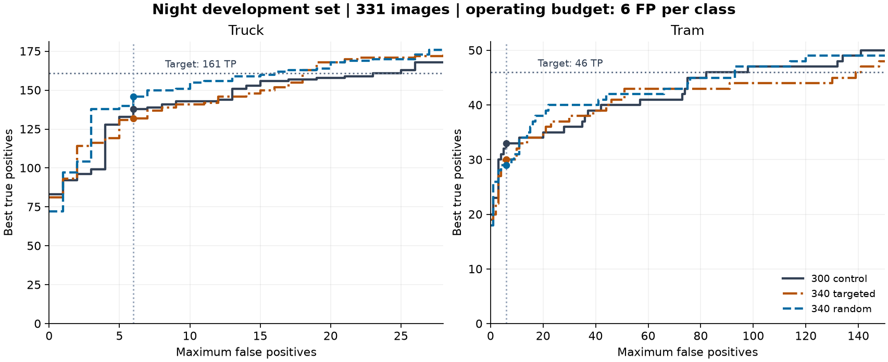

# 夜间目标检测

用有限的夜间标注预算适配 YOLO11m。先冻结白天源模型，再在相同训练配方下比较随机选图、跨视图不一致性选图（E1）和特征代表性与多样性选图（E2）。300 张夜训图让行人、骑行者、汽车达到夜间恢复线，卡车和有轨车辆在 340 张时仍未过线。

[快速运行](#快速运行) · [结果复查](#结果复查) · [数据与权重](#数据与权重) · [许可](#许可)

## 结果

白天源模型 A 在 500 张白天开发图上通过三种子、五类验收，后续共用 seed 17 权重。适配结果使用同一批 500 张白天和 331 张夜间开发图。白天保护要求整体 AP50:95 最多回退 1 个百分点、每类最多回退 2 个百分点。夜间每类最多 6 个误报，召回达到 A 在白天相同每图误报预算下的 80% 即过线。表中的夜间过线数为开发集点估计。[白天结果](reports/a.md#整景尺度适配三种子五类通过) · [评价协议](specs/s5/plan.md#恢复目标)

| 夜训图 | 方案 | 种子数 | 白天保护 | 夜间过线数 | 补充读数 |
| ---: | --- | ---: | --- | --- | --- |
| 100 | 随机 D | 3 | 3/3 通过 | 1/5、2/5、2/5 | 同预算对照 |
| 100 | E1 | 3 | 1/3 通过 | 各 3/5 | 五类宏平均召回比 D 高 4.55 个百分点 |
| 100 | E2 | 3 | 2/3 通过 | 各 3/5 | 五类宏平均召回比 D 高 1.44 个百分点 |
| 300 | 随机 / E1 / 平衡 E2 | 各 1 | 三组均通过 | 各 3/5 | 夜间五类宏平均召回为 37.52% / 39.98% / 39.83% |
| 340 | 定向补 40 / 同折随机补 40 | 各 1 | 两组均通过 | 各 3/5 | 卡车相对各自共用的 300 图控制分别少检 6 个、多检 8 个 |

300 张约占 994 张候选图的 30%，指**单个训练方案**模拟揭示的标签数量。340 图两臂沿用同一 300 图控制、同一训练配方和更新预算。定向补样增加了相关困难材料，但未覆盖多数指定缺口，两臂仍未恢复卡车和有轨车辆。百图五类联合目标未达成，最终留出未开启。[100 图](reports/night.md#百图策略训练) · [300 图](reports/night.md#300-张策略对照) · [340 图](reports/night.md#340-图配对训练)



图中每点是在对应误报上限内，遍历原有预测分数阈值可以达到的最多正确检出数。正式验收取 6 FP。曲线的其余部分用于诊断取舍。

## 快速运行

以下命令在仓库根目录执行，先确认 `python --version` 为 3.12。示例使用 CPU、官方 COCO 预训练 YOLO11n 和随仓库提供的示例照片。首轮安装和下载需要网络。已有兼容环境和可信本地权重时，可直接执行最后一条命令。

```powershell
python -m venv .venv-demo
$demoPython = '.\.venv-demo\Scripts\python.exe'
& $demoPython -m pip install --index-url https://download.pytorch.org/whl/cpu torch==2.8.0 torchvision==0.23.0
& $demoPython -m pip install ultralytics==8.4.171
New-Item -ItemType Directory -Force weights | Out-Null
Invoke-WebRequest https://github.com/ultralytics/assets/releases/download/v8.3.0/yolo11n.pt -OutFile weights/yolo11n.pt
if ((Get-FileHash weights/yolo11n.pt).Hash -ne '0ebbc80d4a7680d14987a577cd21342b65ecfd94632bd9a8da63ae6417644ee1') { throw 'YOLO11n SHA-256 mismatch' }
& $demoPython -B scripts/demo.py
```

输出为 `artifacts/demo/bus.png`，终端打印检出数。用 `--image`、`--weights`、`--output` 指定自己的图片、可信本地检测权重与输出位置。此入口使用单路 640 推理，类别随模型权重变化。正式昼夜结果使用锁定的多视图协议。[示例实现](scripts/demo.py) · [训练与评价环境](environment/README.md)

## 结果复查

- **直接阅读。** [数据划分](reports/data.md) · [白天源模型](reports/a.md) · [夜间主报告与复查索引](reports/night.md#复查) · [项目阶段](plan.md#阶段)。
- **运行无需数据的回归。** 在测试环境执行 `python -m pip install -r environment/data.txt pytest==9.0.2`，再运行 `python -B -m pytest tests/data -q -p no:cacheprovider`。训练和诊断回归的环境与命令见 [环境说明](environment/README.md)。
- **重算正式结果。** 先准备相应冻结划分、权重和完整封存输入，再按 [复查索引](reports/night.md#复查) 选择白天 A、300 图或 340 图验证命令。历史文档里的 `runs/` 与 `data/` 路径是本地证据索引。

## 数据与权重

SODA10M 由使用者从官方入口按条款获取。项目划分使用 4,000 张白天训练图、500 张白天开发图、994 张夜间候选图和 331 张夜间开发图。精确重建还需要风险分组依据、人工复核和已锁选图名单。原图、标签、模型权重及逐图实验记录均由本地维护。[SODA10M 官方下载](https://soda-2d.github.io/download.html) · [数据身份](reports/data.md#身份)

项目权重另行发布，目前无公开下载入口。下表用于识别后续权重，复查时使用相应模型的冻结协议。

| 模型 | 本地封存位置 | SHA-256 |
| --- | --- | --- |
| 白天 A | `runs/align_001/17/last.pt` | `45d212eb674aa60ef2a159652a448cf84eb897ce5a0820ade7dc591fe2afe659` |
| 300 图平衡 E2 | `runs/expand_003/43/last.pt` | `a9544566ad8089001cda191697e624182a69eadad1610de29708dd0c3c1470ea` |

## 许可

本项目原创代码按 [MIT](LICENSE) 授权。Ultralytics 的代码和模型按其上游条款提供，开源分发适用 AGPL-3.0。训练和评价包含对 Ultralytics 训练器、验证器和分配器的扩展，使用及再分发集成工作流时需同时遵守对应的上游许可。SODA10M 数据及由其派生的材料适用其数据条款。示例照片由 Gaurav.raval 拍摄，取自 Wikimedia Commons 的 CC0 1.0 图像，仓库使用去除元数据的缩略版本。[Ultralytics 许可](https://www.ultralytics.com/license) · [SODA10M 条款](https://soda-2d.github.io/about.html#terms_of_use) · [示例图片来源](https://commons.wikimedia.org/wiki/File:GandhinagarCityBus.jpg)
